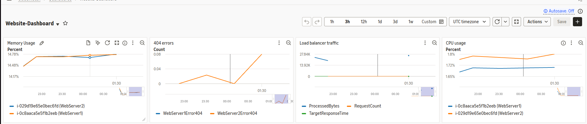
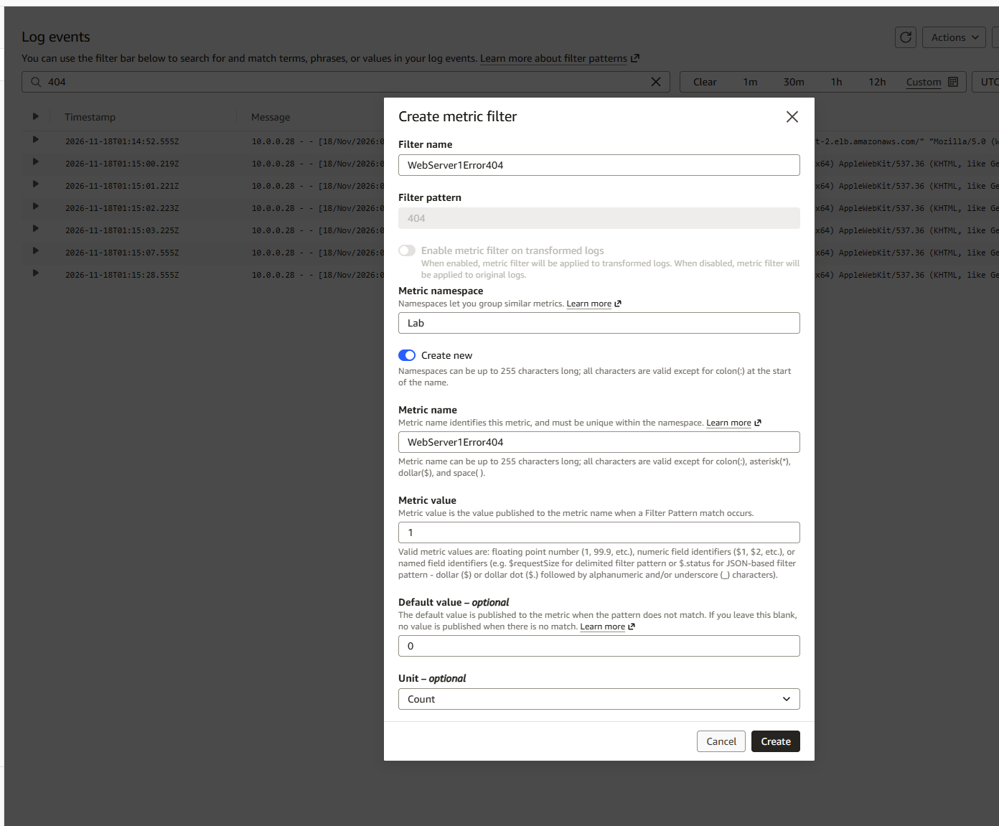
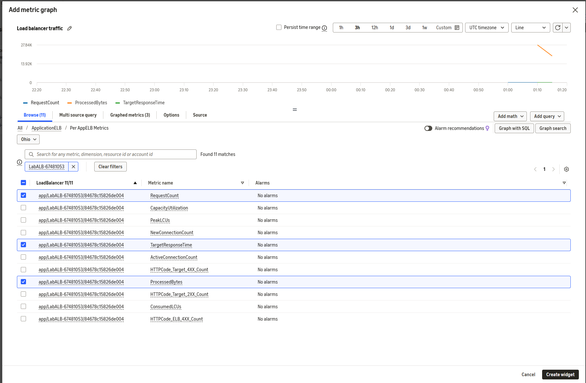
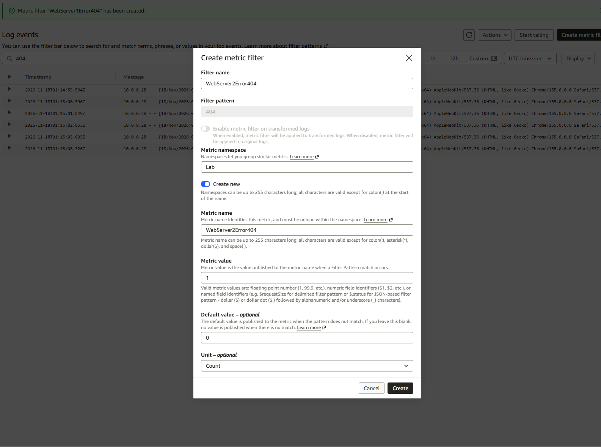
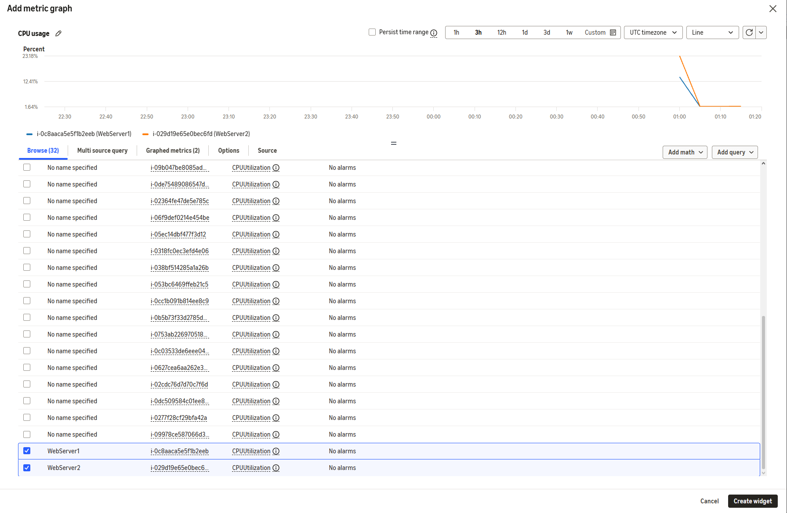

# AWS CloudWatch Website Monitoring Dashboard

**AWS CloudWatch · CloudWatch Logs · Custom Metric Filters · EC2 · Application Load Balancer**  
**MGS 402 guided cloud lab | University at Buffalo | November 2026**

> **Scope:** A guided academic lab using a preconfigured AWS training environment. This work documents dashboard configuration and log-based metric creation; it does not represent a production monitoring deployment, EC2/ALB provisioning, incident response, or alerting implementation.

## Overview

Configured a CloudWatch dashboard named **Website-Dashboard** to examine the performance and behavior of a lab website with two EC2 web servers behind an Application Load Balancer. The dashboard brings infrastructure and application indicators into one view:

| Widget | AWS metric source | Purpose |
| --- | --- | --- |
| Memory Usage | CloudWatch Agent (`CWAgent`, `mem_used_percent`) | Compare memory usage for WebServer1 and WebServer2 |
| 404 errors | Custom metrics (`Lab` namespace) derived from CloudWatch Logs metric filters | Track HTTP 404 occurrences by web server |
| Load balancer traffic | Application Load Balancer metrics (`RequestCount`, `ProcessedBytes`, `TargetResponseTime`) | Inspect request load, throughput, and response time |
| CPU usage | EC2 `CPUUtilization` | Compare CPU utilization across both web servers |

### Dashboard result

## What I did

1. **Configured log-derived error metrics.** In the lab's CloudWatch Logs environment, worked with generated HTTP 404 log events and created metric filters for the two web servers. Used the filter pattern `404`, custom namespace `Lab`, metric value `1` for matches, default value `0`, and unit `Count`.
2. **Created a CloudWatch dashboard.** Selected CloudWatch metrics widgets and configured a consolidated website monitoring view.
3. **Added system monitoring.** Selected the two web servers' EC2 CPU utilization and CloudWatch Agent memory percentage metrics.
4. **Added application/load balancer monitoring.** Graphed `RequestCount`, `ProcessedBytes`, and `TargetResponseTime` for the lab's Application Load Balancer.
5. **Added HTTP error monitoring.** Graphed the two custom web-server 404-error metrics in a single widget for comparison.

## Configuration evidence

| Custom 404 metrics | Infrastructure and traffic metrics |
| --- | --- |
|  |  |
|  |  |

Additional screenshots: [Screenshot evidence inventory](docs/evidence.md).

## What I learned

- CloudWatch dashboards can combine multiple AWS monitoring sources into one operational view.
- **Metric filters** can convert matching log events into time-series metrics; they are not the same as CloudWatch **alarms**.
- Comparing metrics across WebServer1 and WebServer2 can help identify differences in performance or error behavior.
- Load balancer request, throughput, and latency indicators provide different perspectives on service traffic.

## Limitations and next steps

- The training environment contained existing web servers, load balancer resources, and sample log events. I did **not** deploy or architect those resources in this exercise.
- The screenshots show dashboard widgets and custom metrics, but do **not** establish configured alarms, notifications, or an incident-response workflow.
- This was a guided configuration exercise; the screenshot graphs show a limited training time window, not a long-term performance baseline.
- Next practice steps: investigate changes in request and 404 rates, learn CloudWatch alarm conditions, and understand metric dimensions and statistics.

## Evidence and privacy

The screenshots are from a temporary AWS educational environment. This repository deliberately excludes the screenshot showing the full AWS account ID and lab role in the console header. Review all evidence for account identifiers and any data-sharing restrictions before making it public. No credentials or access keys should ever be published.
