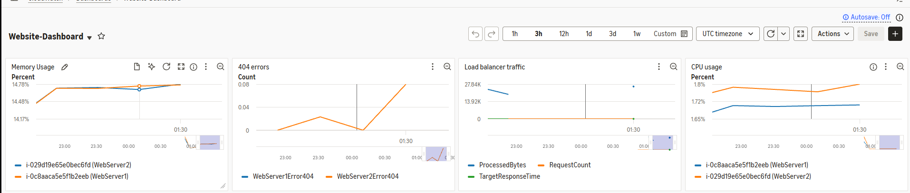
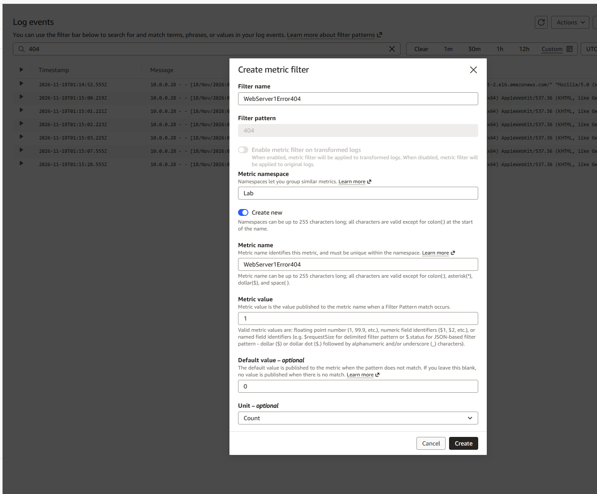
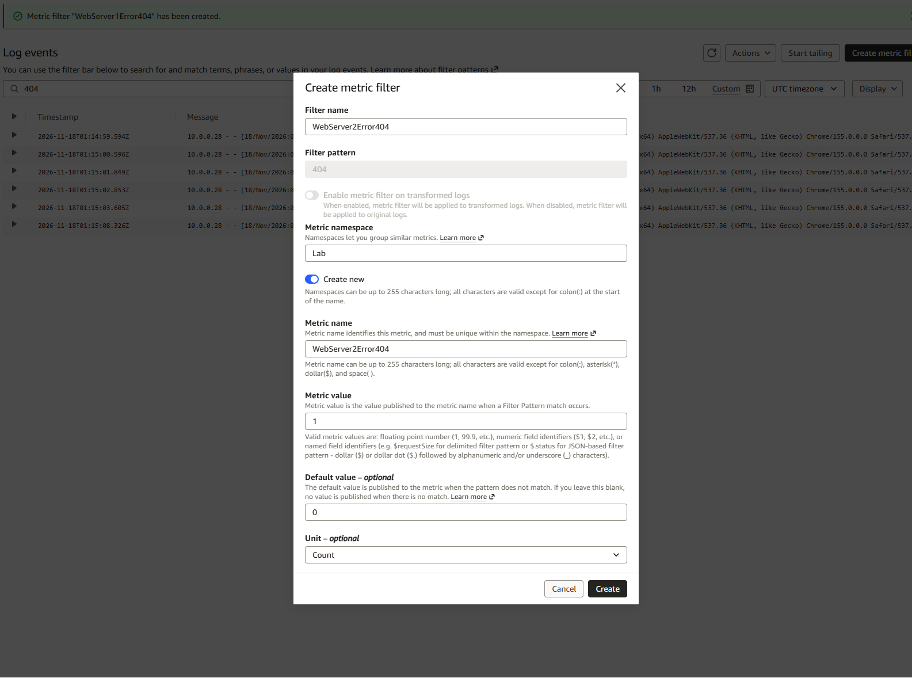
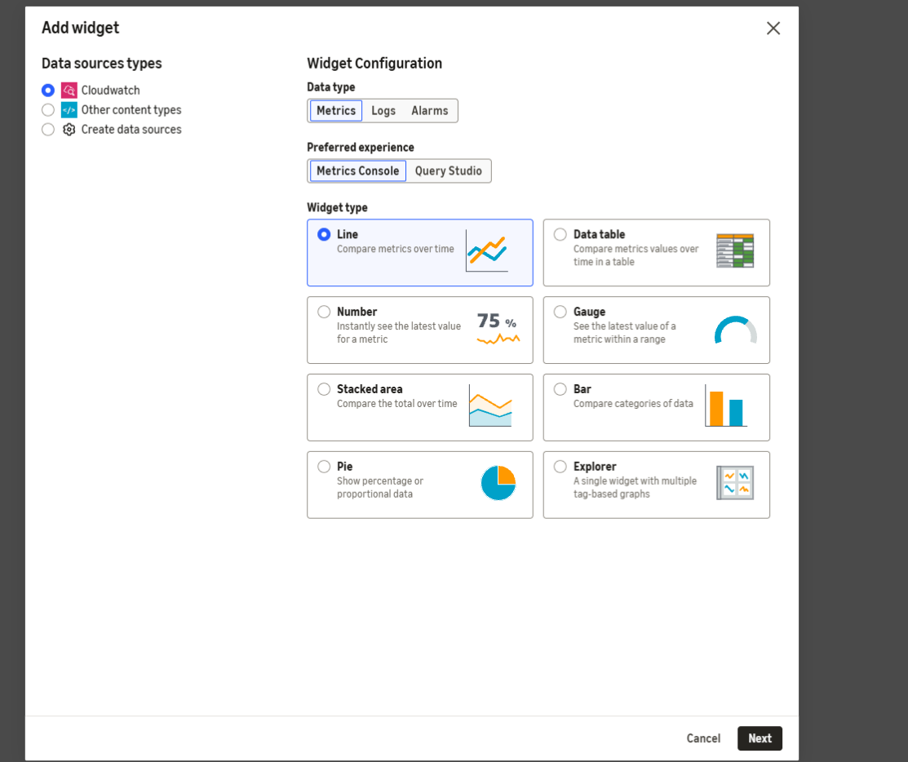
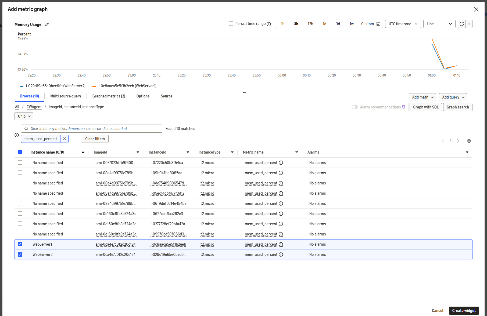
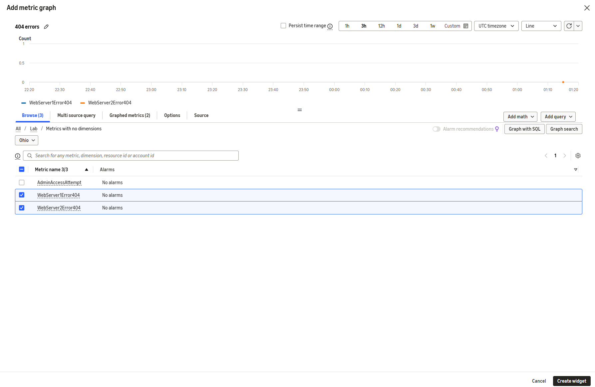
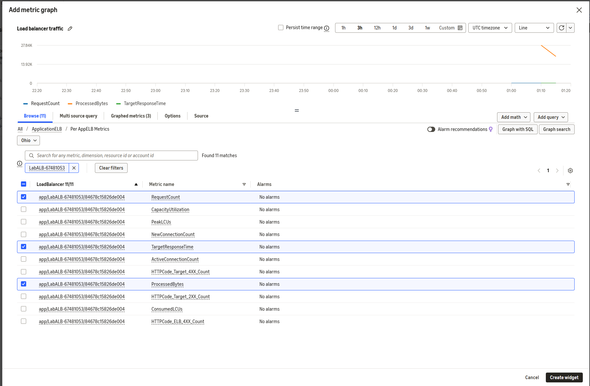
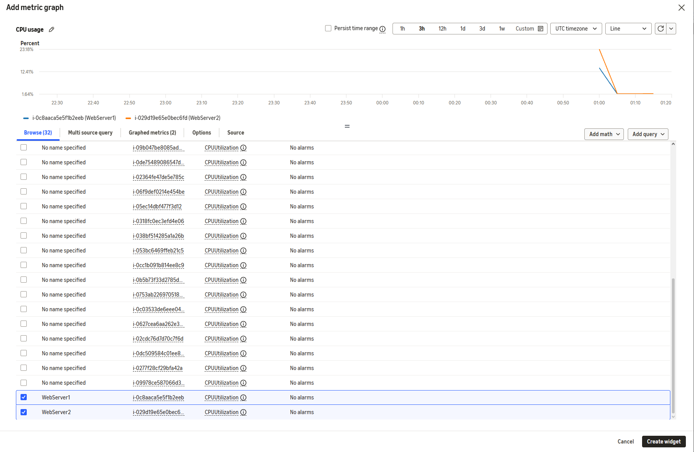

# CloudWatch screenshot evidence

Eight original PNG screenshots from the guided MGS402 lab. See the [evidence inventory](../docs/evidence.md) for context and the [lab README](../README.md) for the completed configuration and limitations.

## Dashboard overview

## Web server 1 HTTP 404 metric filter

## Web server 2 HTTP 404 metric filter

## CloudWatch line widget selection

## CloudWatch Agent memory metric selection

## Custom HTTP 404 metric selection

## Application Load Balancer metric selection

## EC2 CPU utilization metric selection

