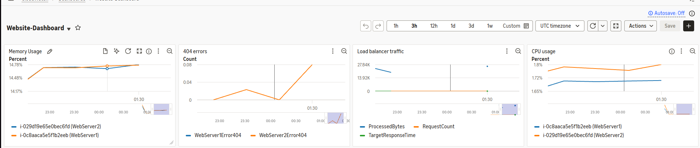

# Cloud Infrastructure Labs

**AWS · Microsoft Azure · Infrastructure · Networking · Monitoring**

A growing portfolio of guided cloud labs and technical documentation by **Yaqub Wafi Ahmed**, a **Management Information Systems student at the University at Buffalo**.

This repository records what I configured, the evidence captured, and the concepts I practiced through coursework. My focus is developing practical foundations for **IT infrastructure, cloud operations, networking, and cybersecurity**.

## Start here

| Lab | Focus | Status |
| --- | --- | --- |
| **[AWS CloudWatch Website Monitoring Dashboard](AWS/CloudWatch-Dashboard/)** | Dashboard configuration, CloudWatch Logs metric filters, EC2 CPU and memory metrics, and Application Load Balancer traffic metrics | Completed guided MGS402 lab · November 2026 |

### First project: monitoring a lab website

Configured **Website-Dashboard** to bring together memory usage, HTTP 404 errors, load-balancer traffic, and CPU utilization for a website running on two preconfigured EC2 web servers behind an Application Load Balancer.

**[Explore the lab →](AWS/CloudWatch-Dashboard/README.md)** · **[Review all eight screenshots →](AWS/CloudWatch-Dashboard/docs/evidence.md)**

## Technical skills demonstrated

| Skill | Evidence from the CloudWatch lab |
| --- | --- |
| **Monitoring configuration** | Created a dashboard and selected metrics from multiple sources for a consolidated view. |
| **Log-derived metrics** | Created HTTP `404` metric filters for two web servers using the `Lab` namespace, a match value of `1`, a default of `0`, and unit `Count`. |
| **Infrastructure metrics** | Selected EC2 `CPUUtilization` and CloudWatch Agent `mem_used_percent` metrics for both servers. |
| **Load-balancer monitoring** | Graphed `RequestCount`, `ProcessedBytes`, and `TargetResponseTime` to examine different aspects of website traffic. |
| **Technical documentation** | Recorded the configuration, screenshots, learning outcomes, and limits of what the exercise demonstrates. |

**Experience level:** These are guided academic exercises in temporary training environments. The first lab demonstrates dashboard and metric-filter configuration; it does not establish independent infrastructure design, production operations, configured alarms, or incident-response experience. EC2 instances and the load balancer were provided by the lab.

## Repository organization

| Location | Contents |
| --- | --- |
| **[AWS/](AWS/)** | Completed AWS labs, each with its own README, screenshots, and supporting documentation. |
| **[Azure/](Azure/)** | Reserved for future Azure coursework. No Azure lab is published here yet. |
| **[docs/lab-template.md](docs/lab-template.md)** | A reusable documentation outline for adding future labs consistently. |

Each lab lives under `<Provider>/<Lab-Name>/`. Lab documentation uses relative links so the screenshots and supporting notes stay together as the portfolio grows.

## Evidence and publication review

- The original CloudWatch lab README, evidence inventory, and eight PNG screenshots are preserved under `AWS/CloudWatch-Dashboard/`.
- Text and screenshots were reviewed before publication. No credentials, access keys, private keys, or full AWS account IDs were found in the supplied files. The images include temporary lab resource identifiers and private lab network addresses.
- The supplied lab README notes that the console-header screenshot displaying the full account ID and lab role was excluded from the ZIP.
- Credentials, local environment files, and common infrastructure state files are excluded by the root `.gitignore`. Ignore rules are a safeguard; every future upload still needs review.

## About

**Yaqub Wafi Ahmed** · Management Information Systems · University at Buffalo  
[GitHub](https://github.com/YWA0987) · [LinkedIn](https://www.linkedin.com/in/yaqub-ahmed/)
